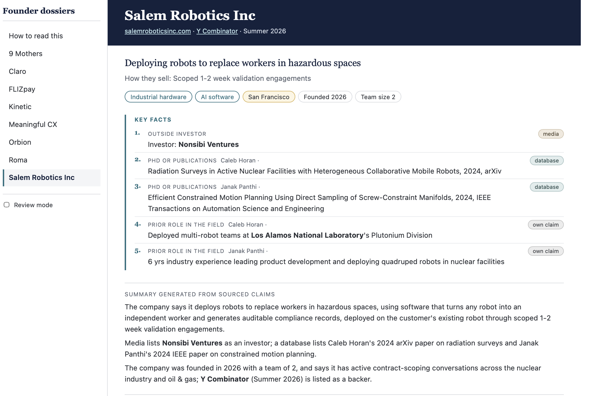

# Founder Dossiers

**Research a whole accelerator batch’s founders in one command. Every line in every dossier points to a quote on a public page, and code checks each quote.**



## Why it exists

Before demo day, a fund’s team has a few days to look at 100+ companies. The first pass is always the same googling: who the founders are, what they did before, and who has backed the company. This tool does that pass for the whole batch, so the team spends its time judging, not searching.

## Why not just use deep research?

- It scales. Give it a list of 100 company links and a budget, and it runs the batch unattended for about $0.24-0.34 per company. Deep research works one company and one prompt at a time.
- Every line is checked. Deep research cites pages, but nothing checks that the sentence is actually on the page. Here, code checks every quote word for word against a stored copy before it reaches the dossier.
- You see how strong each fact is. Each line says who wrote the source (the founder, the company, an investor or accelerator, the media, a database) and whether a party to the fact confirms it.
- It’s structured. Every company gets the same fields, exported as three linked CSVs (companies, people, claims) ready for a CRM.

## How it works

Code decides where to look, the model only reads, and code checks every quote.

1. Code fetches the company’s site, the accelerator page and up to four more pages from the company’s own site, and searches each founder by name.
2. The model (Claude) reads what code collected and proposes claims, each with a value, a source link and a verbatim quote. It cannot browse or search.
3. Code follows the most useful links, looks up publications, searches funding and startup databases, and drops pages that are about someone else.
4. The model reads the new material once more.
5. Code checks every quote against the stored page and rejects failures with a reason. It then groups claims into facts, labels each by source and strength, and picks 3-5 key facts per company.

## Results

I hand-checked every claim for three companies the tool was not tuned on: 66 claims, 0 wrong. That is a small sample, not a guarantee. “Sourced” means a page says it, not that it is true.

## Privacy

LinkedIn and X pages are never opened, robots.txt is honoured, contact-data brokers are excluded, and ages are rejected in code.

## Status

Cost. About $0.24-0.34 per company at list prices: roughly $0.13-0.22 for the model and $0.09-0.14 for search. Search fits Tavily’s free tier for about 60-100 companies a month, so a small batch costs only the model. The model is swappable; a cheaper one cuts the model’s share, but its output needs re-checking, and a fund should check where a provider processes founders’ data.

Next step: testing the CRM import (Attio), so a batch lands in a fund’s pipeline as ready-made records.

## Running it

```bash
python3 -m venv .venv && source .venv/bin/activate
pip install -r requirements.txt
```

Put three keys in `.env` (names only here): `ANTHROPIC_API_KEY`, `TAVILY_API_KEY`, `OPENALEX_API_KEY`.

```bash
python -m src.batch urls.txt --name my_batch --cost-cap 5.00   # a whole batch from a list of company URLs (urls.txt: one URL per line)
python -m src.view runs/<id> runs/<id> --out exports/dossiers.html --label "demo version"   # the page
```
